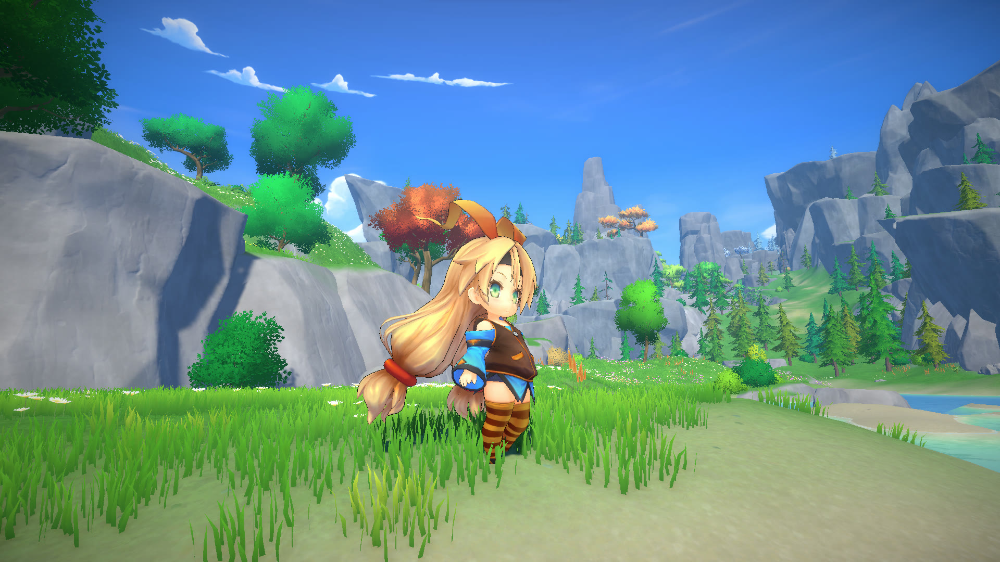
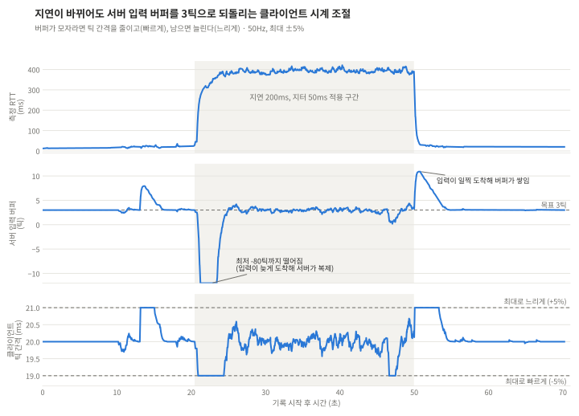

# Project 02

> 개발 중 (2026-08-15 ~) · 이 브랜치(`refactor/simulate-view`)는 ECS 철학으로 구조를 전환한 최신 상태입니다.

Unity 6와 Netcode for GameObjects로 1인 개발 중인 4인 협동 PvE TPS입니다.

서버가 판정하는 구조에서 조작감과 동기화를 직접 구현했습니다.

## 주요 구현

| 주제 | 내용 |
| --- | --- |
| 클라이언트 예측과 재조정 | 입력을 먼저 반영하고, 서버 상태와 어긋나면 되돌려 저장된 입력으로 다시 계산 |
| 서버 입력 큐와 시계 조절 | 서버가 빠짐없이 받았다고 확인(ack)한 다음 틱부터 최대 16틱의 입력을 프레임당 한 번 묶어 전송. 서버 입력 버퍼가 3틱을 유지하도록 클라이언트 틱 속도를 최대 ±5% 조절 |
| RTT 직접 측정 | NGO의 RTT는 신뢰 전송의 ACK 기준이라 입력·상태를 비신뢰 전송으로 보내는 구조에서는 제대로 갱신되지 않아, 입력 송신과 상태 수신 시각으로 직접 측정 |
| 스냅샷 보간 | 다른 플레이어와 적을 5틱(100ms) 뒤에서 보간해 표시 |
| 시각 보간 | 50Hz 틱 사이를 렌더 프레임마다 보간해, 몸과 머리카락(Spring Bone)의 덜컥거림을 제거 |
| 지연 보상 | 서버가 쏜 사람이 보던 시점으로 적을 되감아 선분과 캡슐 교차로 판정 |
| ECS 철학의 구조 | 상태는 Component, 동작은 정적 System. 실행 순서는 `ServerLoop`, `ClientLoop` 한 곳에 ([규칙 문서](./ECS_RULES.md)) |

## 구조: ECS 철학 도입

오버워치 GDC 2017 강연에서 ECS로 게임플레이와 넷코드를 정리한 사례를 참고했습니다.
Netcode for Entities도 검토했지만, 적이 수백 마리를 넘지 않는 규모이고 목적이 성능이 아닌 구조였기에 패키지 없이 철학만 가져왔습니다.

- 상태는 Component(데이터), 동작은 필드 없는 정적 System, NGO 생명주기는 Authoring, 엔진 출력은 View로 나눔
- 역할 판단(`IsOwner`, `IsServer`)은 등록 시점에만. System 24개(서버 13, 클라이언트 11) 안에는 역할 분기가 없음
- 코드 위치를 정하는 9단계 판단 순서를 [`ECS_RULES.md`](./ECS_RULES.md)에 정리

| 전환 전: 총알 한 발이 이벤트 연쇄로 퍼짐 | 전환 후: 서버 루프 한 곳에 순서대로 |
| --- | --- |
|  |  |

## 클라이언트 예측과 재조정

예측을 켠 상태에서 네트워크 조건을 바꿔 가며 재조정 횟수를 세고, 비교용으로 예측을 끈 상태의 입력 지연을 측정했습니다.
입력 지연은 이동 키를 누른 프레임부터 캐릭터가 1cm 움직인 프레임까지의 시간입니다.
측정 조건은 144fps, 50Hz 틱, 조건마다 25회입니다. 1초 이상 정지한 상태에서 시작했고, 이동만 측정했습니다.

| 네트워크 조건 | 측정 RTT | 예측 ON 재조정 | 예측 OFF 입력 지연(중앙값) |
| --- | --- | --- | --- |
| 지연 0 | 약 21ms | 0회 | 89.7ms |
| 지연 100ms | 약 227ms | 0회 | 291.5ms |
| 지연 200ms, 지터 50ms | 약 400ms | 0회 | 464.8ms |
| 지연 200ms, 지터 50ms, 손실 10% | 약 400ms | 0회 | 472.0ms |

- 예측을 켜면 입력 지연은 모든 조건에서 1틱(20ms) 이내이고, 예측과 서버 결과가 어긋난 재조정은 0회입니다.
- 예측을 끄면 입력 지연은 RTT + 약 65ms입니다. 그중 60ms는 지터를 흡수하려고 둔 서버 입력 버퍼 3틱이고, 나머지는 다음 틱과 프레임을 기다리는 시간입니다.

## 서버 입력 큐와 클라이언트 시계 조절

지연을 켜면 입력이 늦게 도착해 버퍼가 줄고, 클라이언트가 틱 간격을 줄여(빠르게) 3틱으로 되돌립니다.
지연을 끄면 입력이 일찍 도착해 버퍼가 쌓이고, 틱 간격을 늘려(느리게) 되돌립니다.
±5%로 따라잡을 수 없는 어긋남은 시계를 한 번에 옮겨 재동기화합니다.

## 지연 보상

- 초록 십자선: 쏜 사람의 화면에 보이던 적의 위치 (판정에 사용)
- 빨강 십자선: 같은 순간 서버에서의 적의 위치
- 흰색 선: 되감은 거리
- 노란 선: 명중한 틱에 탄이 날아간 구간

노란 선이 초록 십자선의 판정 범위(반지름 0.6m 구) 안에서 끝나면 명중입니다. 되감지 않았다면 빗나갔을 탄입니다.
PvE라 플레이어의 탄이 맞히는 대상은 적(AI)뿐이어서, 대전 게임의 "엄폐했는데 맞는" 문제가 생기지 않습니다.

## 저장

- 진행도는 세계 단위 `.sav` 하나에 저장합니다 (내용은 JSON). 스키마 `SaveFile { Version, SavedAt, World, Players[] }`.
- 싱글: 슬롯 6개 고정, 슬롯마다 파일 하나. 전용 서버: `server.sav` 하나. 스키마는 같습니다.
- 저장 파일은 여는 쪽(`ServerLauncher` / 싱글 시작)이 `ProgressService.Open`으로 명시적으로 열고 `Close`로 닫습니다.
- 보상은 메모리에 반영하고 10초마다, 그리고 접속 종료·서버 정지(`OnServerStopped`)·`Close`·종료 시 저장합니다. 크래시 시 최대 10초분을 잃습니다.
  저장에 실패하면 변경 표시를 남겨 다음 주기에 다시 시도합니다. `Register`와 새 파일 생성은 그 자리에서 즉시 저장합니다.
- 읽기 실패한 파일은 `.corrupt-<시각>`으로 옮기고(격리) 시작하지 않습니다. 이 빌드보다 새 버전 파일은 손대지 않고 시작하지 않습니다.
  진행도를 잃느니 시작하지 않습니다. 복구는 관리자가 파일을 보고 정합니다.
- 전용 서버 초기화는 관리자가 파일을 지우는 것으로 합니다 (게임 안에 초기화 기능 없음).

## 알려진 한계

- **다른 플레이어의 발사 연출이 빠질 수 있음:** 발사 연출 RPC를 Unreliable로 보내므로, 패킷이 유실되면 다른 플레이어 화면에서 그 탄도가 그려지지 않습니다. 피해는 서버가 판정하므로 빠지는 것은 연출뿐입니다. Reliable로 보내면 유실 하나를 재전송하는 동안(약 RTT) 뒤의 발사까지 묶여, 보간 지연(5틱, 100ms)을 넘겨 도착한 발사들이 한꺼번에 재생됩니다(지연 200ms, 손실 10%에서 확인). 그래서 빠지더라도 고르게 보이는 쪽을 택했습니다. Source 엔진의 임시 엔티티와 같은 선택입니다([ECS 규칙 12](./ECS_RULES.md)). 최근 발사를 매 틱 가는 스냅샷에 실어 몸과 같은 타임라인에서 재생하는 방식으로 옮겨 유실을 없앨 계획입니다.
- **되감기 상한을 넘는 지연에서 피격 이펙트 오예측:** 서버는 최대 25틱(500ms)까지만 되감습니다. 이보다 지연이 큰 클라이언트는 예측한 피격 이펙트가 나도 실제 피해가 없을 수 있습니다. 강연처럼 상한을 넘는 클라이언트에서 적을 외삽해 그리는 방식을 시도했지만, 지연 200ms, 지터 30ms, 손실 30%에서 적이 끊겨 보여 되돌렸습니다.
- **조준점이 가까울 때 캐릭터 모델의 Y 회전 떨림:** Animator가 매 프레임 `Player Visual`의 회전을 되돌리고 `Face()`가 `TurnSpeed × dt`만 돌려서, 보이는 각도가 프레임 시간에 따라 바뀝니다. 60fps 고정에서는 보이지 않고, vSync를 끈 144fps에서 드러납니다. Animator가 없는 부모 Transform을 돌리는 방식으로 고칠 예정입니다.