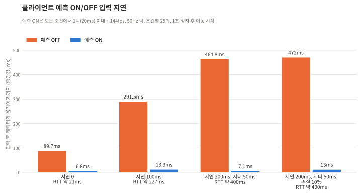

# Project 02

> 개발 중 (2026-08-15 ~) · 이 브랜치(`refactor/simulate-view`)는 ECS 철학으로 구조를 전환한 최신 상태입니다.

Unity 6와 Netcode for GameObjects로 1인 개발 중인 4인 협동 PvE TPS입니다.

서버가 판정하는 구조에서 조작감과 동기화를 직접 구현했습니다.

## 주요 구현

| 주제 | 내용 |
| --- | --- |
| 클라이언트 예측과 재조정 | 입력을 먼저 반영하고, 서버 상태와 어긋나면 되돌려 저장된 입력으로 다시 계산 |
| 서버 입력 큐와 시계 조절 | 최근 3틱 입력을 묶어 전송. 서버 입력 버퍼가 3틱을 유지하도록 클라이언트 틱 속도를 최대 ±5% 조절 |
| RTT 직접 측정 | NGO의 RTT는 신뢰 전송의 ACK 기준이라 비신뢰 전송만 쓰는 구조에서 갱신되지 않아, 입력 송신과 상태 수신 시각으로 직접 측정 |
| 스냅샷 보간 | 다른 플레이어와 적을 5틱(100ms) 뒤에서 보간해 표시 |
| 시각 보간 | 50Hz 틱 사이를 렌더 프레임마다 보간해, 몸과 머리카락(Spring Bone)의 덜컥거림을 제거 |
| 지연 보상 | 서버가 쏜 사람이 보던 시점으로 적을 되감아 선분과 캡슐 교차로 판정 |
| ECS 철학의 구조 | 상태는 Component, 동작은 정적 System. 실행 순서는 `ServerLoop`, `ClientLoop` 한 곳에 ([규칙 문서](./ECS_RULES.md)) |

## 구조: ECS 철학 도입

오버워치 GDC 2017 강연에서 ECS로 게임플레이와 넷코드를 정리한 사례를 참고했습니다.
Netcode for Entities도 검토했지만, 적이 수백 마리를 넘지 않는 규모이고 목적이 성능이 아닌 구조였기에 패키지 없이 철학만 가져왔습니다.

- 상태는 Component(데이터), 동작은 필드 없는 정적 System, NGO 생명주기는 Authoring, 엔진 출력은 View로 나눔
- 역할 판단(`IsOwner`, `IsServer`)은 등록 시점에만. System 22개(서버 12, 클라이언트 10) 안에는 역할 분기가 없음
- 코드 위치를 정하는 9단계 판단 순서를 [`ECS_RULES.md`](./ECS_RULES.md)에 정리

| 전환 전: 총알 한 발이 이벤트 연쇄로 퍼짐 | 전환 후: 서버 루프 한 곳에 순서대로 |
| --- | --- |
|  |  |

## 클라이언트 예측 ON/OFF 입력 지연

이동 키를 누른 프레임부터 캐릭터가 1cm 움직인 프레임까지의 시간입니다.
144fps, 50Hz 틱, 조건마다 25회, 1초 이상 정지한 상태에서 시작, 이동만 측정했습니다.

| 네트워크 조건 | 측정 RTT | 예측 OFF 중앙값 (p95) | 예측 ON 중앙값 (최대) |
| --- | --- | --- | --- |
| 지연 0 | 약 21ms | 89.7ms (97.3) | 6.8ms (13.9) |
| 지연 100ms | 약 227ms | 291.5ms (298.9) | 13.3ms (14.3) |
| 지연 200ms, 지터 50ms | 약 400ms | 464.8ms (492.5) | 7.1ms (14.2) |
| 지연 200ms, 지터 50ms, 손실 10% | 약 400ms | 472.0ms (506.5) | 13.0ms (14.1) |

- 예측 OFF는 RTT + 약 60ms를 따라갑니다. 60ms는 지터를 흡수하려고 둔 서버 입력 버퍼 3틱입니다.
- 예측 ON은 네트워크 조건과 무관하게 1틱(20ms) 이내입니다. 값이 7ms와 13ms로 갈리는 건 키를 누른 순간과 다음 틱 사이의 위상 차이(1~2프레임)입니다.

## 서버 입력 큐와 클라이언트 시계 조절

지연을 켜면 입력이 늦게 도착해 버퍼가 줄고, 클라이언트가 틱 간격을 줄여(빠르게) 3틱으로 되돌립니다.
지연을 끄면 입력이 일찍 도착해 버퍼가 쌓이고, 틱 간격을 늘려(느리게) 되돌립니다.
±5%로 따라잡을 수 없는 어긋남은 시계를 한 번에 옮겨 재동기화합니다.

## 지연 보상

- 초록 십자선: 쏜 사람의 화면에 보이던 적의 위치 (판정에 사용)
- 빨강 십자선: 같은 순간 서버에서의 적의 위치
- 흰색 선: 되감은 거리
- 노란 선: 명중한 틱에 탄이 날아간 구간

노란 선이 초록 십자선의 판정 범위(반지름 0.6m 구) 안에서 끝나면 명중입니다. 되감지 않았다면 빗나갔을 탄입니다.
PvE라 되감는 대상은 적(AI)뿐이어서, 대전 게임의 "엄폐했는데 맞는" 문제가 생기지 않습니다.

## 결정 기록

- **발사 RPC를 Unreliable로:** 지연 200ms, 손실 10%에서 다른 플레이어의 연사가 몰려 보인 원인은 신뢰 전송 RPC의 재전송 대기였습니다. 피해는 서버가 판정하므로 연출만 유실될 수 있다고 보고, RPC 전달 방식만 바꿔 해결했습니다. 판정과 연출이 다른 경로라는 한계가 남아, 발사 연출도 시뮬레이션 상태에서 끌어내는 방식으로 옮길 계획입니다.
- **RTT 직접 측정:** NGO가 보고하는 RTT가 지연을 추가해도 바뀌지 않는 것을 측정 중 발견했습니다. 재동기화에 쓰는 RTT를 직접 잰 값으로 바꿨습니다.

## 알려진 문제

- 조준점이 가까울 때 캐릭터 모델의 Y 회전이 떨립니다. Animator가 매 프레임 `Player Visual`의 회전을 되돌리고 `Face()`가 `TurnSpeed × dt`만 돌려서, 보이는 각도가 프레임 시간에 따라 바뀝니다. 60fps 고정에서는 보이지 않고, vSync를 끈 144fps에서 드러납니다. Animator가 없는 부모 Transform을 돌리는 방식으로 고칠 예정입니다.